<h1 align="center">TaskbarVisu</h1>

<p align="center">
  
</p>

<p align="center">
  <b>Des visualiseurs audio intégrés à la barre des tâches de Windows 11.</b><br>
  Pas de fenêtre, pas de cadre. Votre musique, dessinée dans l'espace vide à côté de vos icônes.
</p>

<p align="center">
  <a href="https://github.com/Myupavision/TaskbarVisu/releases/latest"><b>Télécharger pour Windows 11</b></a>
  &nbsp;·&nbsp;
  <a href="README.md">English</a>
  &nbsp;·&nbsp;
  <a href="docs/TECHNIQUE.md">Notes techniques</a>
</p>

## Pour votre setup

Des visuels qui bougent avec ce qui joue, d'un jeu à une playlist.

<table>
  <tr>
    <td width="50%">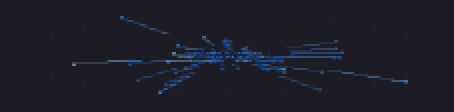<br><b>Hyperespace</b> : un champ d'étoiles qui fonce vers vous. Chaque fréquence fait naître ses étoiles, la vitesse suit la musique.</td>
    <td width="50%">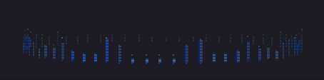<br><b>Anneau</b> : le spectre enroulé en cercle. Il respire sur les basses et tourne du côté de la stéréo.</td>
  </tr>
  <tr>
    <td>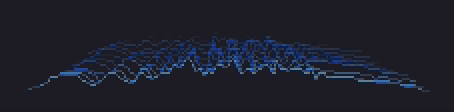<br><b>Cascade</b> : une ligne de spectre par instant, empilées comme des montagnes qui reculent.</td>
    <td>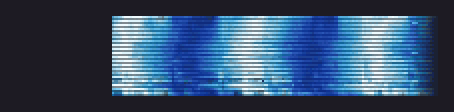<br><b>Spectrogramme</b> : l'historique de chaque fréquence, qui défile, coloré selon l'intensité.</td>
  </tr>
  <tr>
    <td>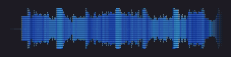<br><b>Forme d'onde</b> : miroir, enveloppe ou oscilloscope déclenché.</td>
    <td>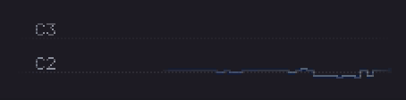<br><b>Mélodie</b> : la note dominante laisse une traînée lumineuse sur une grille de notes, glissés compris.</td>
  </tr>
</table>

## Pour votre mix

De vrais instruments de mesure, toujours visibles pendant que vous produisez, mixez ou travaillez votre instrument.

<table>
  <tr>
    <td width="50%">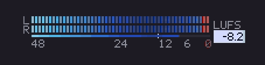<br><b>Niveaux + LUFS</b> : crête-mètre G/D avec maintien et écrêtage, sonie BS.1770 face à votre cible.</td>
    <td width="50%">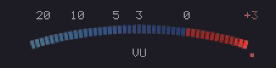<br><b>VU-mètre</b> : arc LED ou aiguille analogique, balistique ~300 ms, mono ou stéréo.</td>
  </tr>
  <tr>
    <td>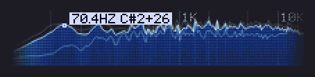<br><b>Spectre</b> : relief, barres, points LED ou ligne, avec crêtes maintenues et la fréquence et la note du pic.</td>
    <td>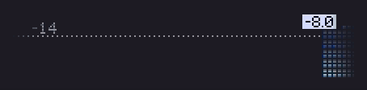<br><b>Historique de sonie</b> : les LUFS sur 15 s à 5 min, face à votre cible.</td>
  </tr>
  <tr>
    <td>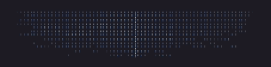<br><b>Imageur stéréo</b> : où se place chaque fréquence entre gauche et droite, avec la corrélation de phase.</td>
    <td>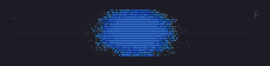<br><b>Oscilloscope XY</b> : goniomètre ou Lissajous en phosphore qui s'éteint lentement, comme un écran cathodique.</td>
  </tr>
  <tr>
    <td>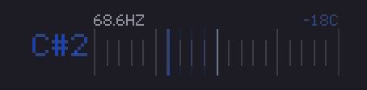<br><b>Accordeur / tonalité</b> : la note et son écart en cents, ou la tonalité du morceau sur un mini-piano (C D E, Do Ré Mi ou Camelot).</td>
    <td>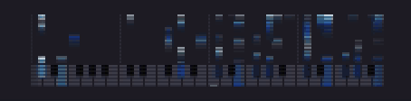<br><b>Piano roll</b> : les notes réellement jouées, octave comprise, harmoniques filtrées.</td>
  </tr>
</table>

<details>
<summary><b>Un dernier, pour les curieux</b></summary>
<br>
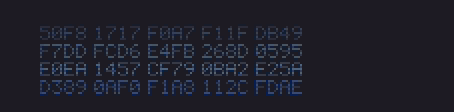<br>
<b>Données brutes</b> : les échantillons tels que la carte son les voit, en hexadécimal qui défile ou en matrice de bits. Purement expérimental.
</details>

## Choisissez un look

<p align="center">
  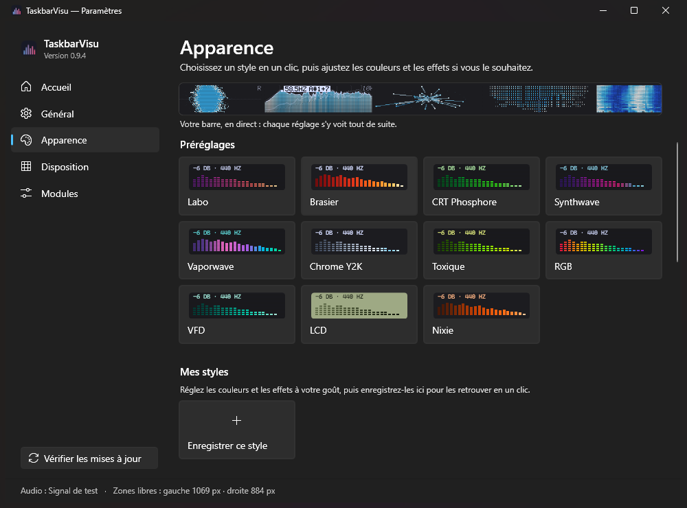
</p>

Onze préréglages en un clic, de *Labo* et *CRT Phosphore* aux looks matériels : *VFD*, *LCD*, *Nixie*.
Puis affinez : 16 palettes, vos propres dégradés, animation des couleurs, lignes de balayage, police pixel ou lisse.
Enregistrez un style sous un nom, ou partagez-le avec un court code `TBV1:…`.

## Pourquoi il s'intègre si bien

- **Il trouve sa place.** Il détecte la barre tout seul : en haut ou en bas, compacte, à tout DPI, icônes centrées ou à gauche. Écran principal, un écran choisi, ou tous.
- **Il écoute ce que vous choisissez.** Tout le PC, une sortie, une seule appli (FL Studio sans Discord), ou un micro ou une entrée ligne.
- **Les chiffres sont vrais.** La sonie suit la norme UIT-R BS.1770. La détection de tonalité est vérifiée sur un [banc de test](tests/key-bench.csv) de vrais morceaux, de morceaux synthétiques, de voix et de bruit, et affiche `--` plutôt que de deviner.
- **Il reste léger.** Environ 4 % d'un cœur à 60 images/s, environ 0 % dans le silence. Les clics le traversent, il ne gêne jamais.
- **Il sait se faire oublier.** Un raccourci global le masque (Ctrl + Alt + V par défaut, même en jeu), et avec l'installeur, une mise à jour prend un clic.

Au premier lancement, un petit guide éclaire l'espace libre sur votre vraie barre des tâches et vous fait choisir un look et un pack de modules. Interface en français, anglais, espagnol et allemand.

## Télécharger

Depuis la [dernière version](https://github.com/Myupavision/TaskbarVisu/releases/latest) :

- **Installeur** `TaskbarVisu-x.y.z-setup.exe` : sans droits administrateur, entrée dans le menu Démarrer, désinstallation propre, mises à jour dans l'app.
- **Portable** `TaskbarVisu-x.y.z-portable.zip` : un seul `.exe`, rien à installer.

Windows 11 x64 avec une barre des tâches horizontale. L'app n'est pas encore signée : si SmartScreen affiche *Éditeur inconnu*, cliquez sur *Informations complémentaires*, puis *Exécuter quand même*.

<details>
<summary><b>Compiler depuis les sources</b></summary>
<br>

Avec le SDK .NET 10 :

```
dotnet run --project src/TaskbarVisu -c Release
```

Version complète (exe autonome, zip portable, installeur Inno Setup 6, sommes SHA-256 et manifestes winget dans `build/` ; rien n'est publié) :

```
powershell -File tools/build-release.ps1
```

Le fonctionnement détaillé (traitement du signal, détection de tonalité, banc de test, options de diagnostic) est dans [docs/TECHNIQUE.md](docs/TECHNIQUE.md).
</details>

## Licence

[GPL-3.0](LICENSE). Construit avec [NAudio](https://github.com/naudio/NAudio) et [SkiaSharp](https://github.com/mono/SkiaSharp) (tous deux MIT). Inspiré de MiniMeters, sans lien avec ce logiciel.
