<h1 align="center">TaskbarVisu</h1>

<p align="center">
  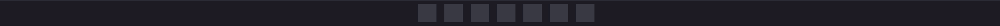
</p>

<p align="center">
  <b>Audio visualizers that live inside the Windows 11 taskbar.</b><br>
  No window, no frame. Your music, drawn into the empty space beside your icons.
</p>

<p align="center">
  <a href="https://github.com/Myupavision/TaskbarVisu/releases/latest"><b>Download for Windows 11</b></a>
  &nbsp;·&nbsp;
  <a href="README.fr.md">Français</a>
  &nbsp;·&nbsp;
  <a href="docs/TECHNIQUE.md">Technical notes (FR)</a>
</p>

## For your setup

Visuals that move with whatever is playing, from a game to a playlist.

<table>
  <tr>
    <td width="50%">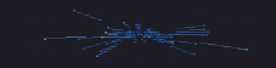<br><b>Hyperspace</b>: a starfield rushing at you. Each frequency spawns its stars, speed follows the music.</td>
    <td width="50%">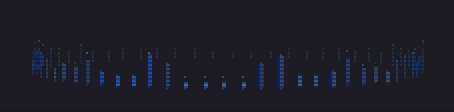<br><b>Ring</b>: the spectrum wrapped into a circle. It breathes on the bass and turns toward the stereo side.</td>
  </tr>
  <tr>
    <td>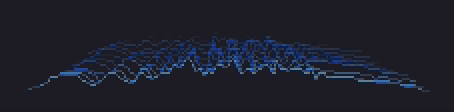<br><b>Waterfall</b>: one spectrum line per moment, stacked like mountains that recede.</td>
    <td>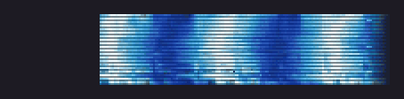<br><b>Spectrogram</b>: the history of every frequency, scrolling and coloured by intensity.</td>
  </tr>
  <tr>
    <td>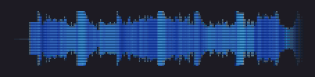<br><b>Waveform</b>: mirror, envelope or triggered oscilloscope.</td>
    <td>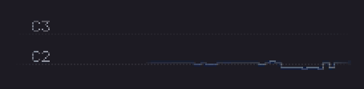<br><b>Melody</b>: the leading note leaves a glowing trail on a note grid, slides included.</td>
  </tr>
</table>

## For your mix

Real meters, always in view while you produce, mix or practise.

<table>
  <tr>
    <td width="50%">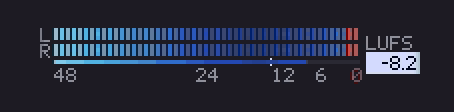<br><b>Levels + LUFS</b>: L/R peak meter with peak hold and clip, BS.1770 loudness against your target.</td>
    <td width="50%">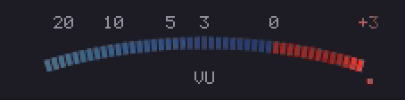<br><b>VU meter</b>: LED arc or analogue needle, ~300 ms ballistics, mono or stereo.</td>
  </tr>
  <tr>
    <td>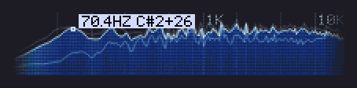<br><b>Spectrum</b>: relief, bars, LED dots or line, with held peaks and the peak's frequency and note.</td>
    <td>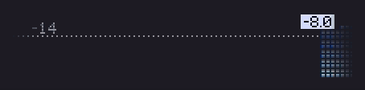<br><b>Loudness history</b>: LUFS over 15 s to 5 min, against your target.</td>
  </tr>
  <tr>
    <td>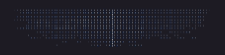<br><b>Stereo imager</b>: where each frequency sits between left and right, with phase correlation.</td>
    <td>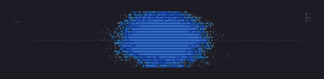<br><b>XY oscilloscope</b>: goniometer or Lissajous in phosphor that fades like a CRT.</td>
  </tr>
  <tr>
    <td>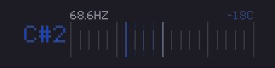<br><b>Tuner / key</b>: the note and how many cents off, or the song's key on a mini piano (C D E, Do Ré Mi or Camelot).</td>
    <td>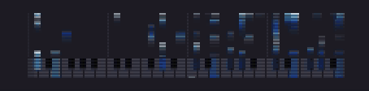<br><b>Piano roll</b>: the notes actually played, octave included, with harmonics filtered out.</td>
  </tr>
</table>

<details>
<summary><b>One more, for the curious</b></summary>
<br>
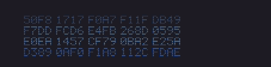<br>
<b>Raw data</b>: the samples as your sound card sees them, in scrolling hex or a bit matrix. Purely experimental.
</details>

## Pick a look

<p align="center">
  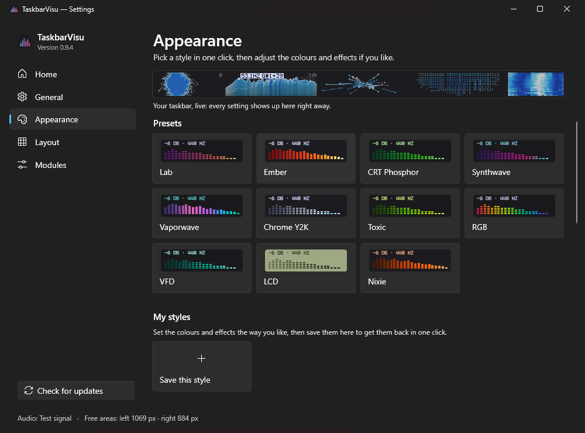
</p>

Eleven presets in one click, from *Lab* and *CRT Phosphor* to hardware looks: *VFD*, *LCD*, *Nixie*.
Then tune it: 16 palettes, your own gradients, colour animation, scanlines, a pixel or smooth font.
Save a style under a name, or share it as a short `TBV1:…` code.

## Why it feels at home

- **It finds its place.** Detects the taskbar on its own: top or bottom, compact, any DPI, centred or left-aligned icons. Main screen, a chosen one, or all of them.
- **It listens to what you choose.** The whole PC, one output, one app only (FL Studio without Discord), or a mic or line input.
- **The numbers are real.** Loudness follows ITU-R BS.1770. Key detection is checked against a [test bench](tests/key-bench.csv) of real songs, synthetic songs, speech and noise, and shows `--` rather than guessing.
- **It stays light.** About 4 % of one CPU core at 60 fps, about 0 % in silence. Click-through, so it never gets in the way.
- **It keeps out of your way.** A global hotkey hides it (Ctrl + Alt + V by default, even in games), and with the installer, updates take one click.

On first launch, a short guide lights up the free space on your real taskbar and lets you pick a look and a module pack. Interface in English, French, Spanish and German.

## Download

From the [latest release](https://github.com/Myupavision/TaskbarVisu/releases/latest):

- **Installer** `TaskbarVisu-x.y.z-setup.exe`: no admin rights, Start menu entry, clean uninstall, in-app updates.
- **Portable** `TaskbarVisu-x.y.z-portable.zip`: one `.exe`, nothing to install.

Windows 11 x64 with a horizontal taskbar. The app is not code-signed yet: if SmartScreen shows *Unknown publisher*, click *More info*, then *Run anyway*.

<details>
<summary><b>Build from source</b></summary>
<br>

With the .NET 10 SDK:

```
dotnet run --project src/TaskbarVisu -c Release
```

Full release build (self-contained exe, portable zip, Inno Setup 6 installer, SHA-256 sums and winget manifests in `build/`; nothing is published):

```
powershell -File tools/build-release.ps1
```

How it works (DSP, key detection, test bench, diagnostic flags) is documented in French in [docs/TECHNIQUE.md](docs/TECHNIQUE.md).
</details>

## License

[GPL-3.0](LICENSE). Built with [NAudio](https://github.com/naudio/NAudio) and [SkiaSharp](https://github.com/mono/SkiaSharp) (both MIT). Inspired by MiniMeters; not affiliated with it.
